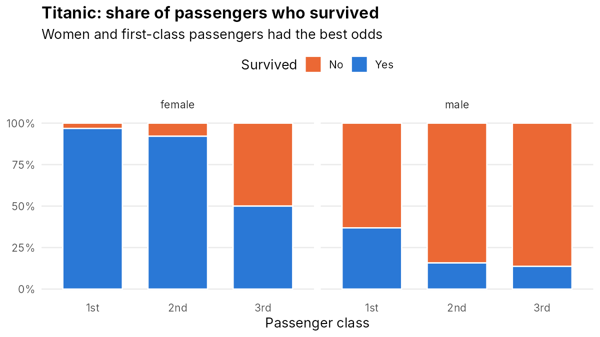
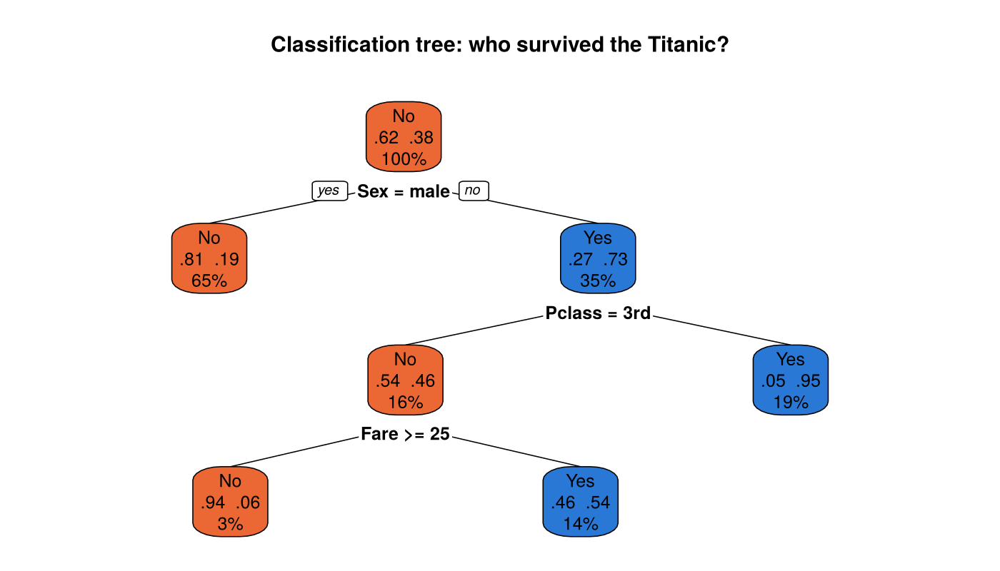
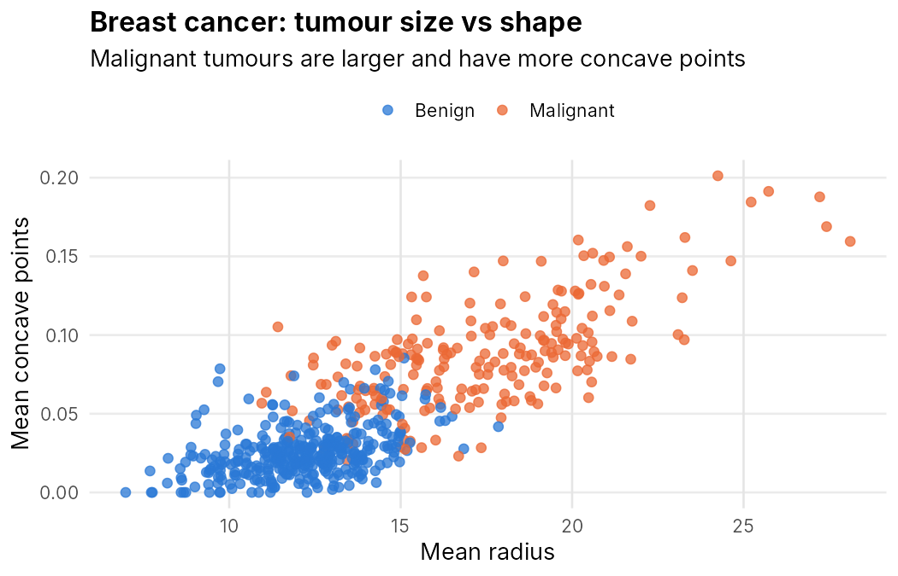

# Intro to Data Science in R

My code from **Introduction to Data Science** at Universidad Carlos III de Madrid (UC3M), fall 2026, during my Erasmus+ exchange semester.

The repo follows the course step by step: from the first `read.csv()` to tuning a decision tree with cross-validation. Every script runs on its own, uses the datasets in `data/`, and is commented so it can be read as notes.



## What I have practised

| Area | Topics |
| --- | --- |
| **R basics** | data types, vectors, data frames, indexing, logical filters, `if`/`else`, `for` loops |
| **Algorithms** | Fibonacci, square root by iteration, Maclaurin series for e^x, Sieve of Eratosthenes |
| **Visualisation** | `ggplot2`: bar charts, histograms, scatter plots, boxplots, facets |
| **Supervised learning** | classification trees with `rpart`, classification vs regression trees, train/test split |
| **Model evaluation** | confusion matrix, accuracy, precision, recall, specificity |
| **Model tuning** | hyperparameters, grid search, 5-fold cross-validation |

## Project structure

```
├── 01_r_basics/
│   ├── 01_importing_data.R            read.csv, inspecting a dataset
│   ├── 02_data_types_and_logic.R      types, logical filters, Titanic questions
│   ├── 03_vectors_and_dataframes.R    vectors, data frames, seq() and rep()
│   ├── 04_penguins_exercises.R        46 exercises: penguins data, vectors, data frames
│   ├── 05_conditionals_and_loops.R    if/else, for loops, loop vs vectorised
│   └── 06_loop_algorithms.R           Fibonacci, sqrt(2), e^x, prime sieve
├── 02_visualization/
│   ├── 07_ggplot_basics.R             bar charts, histograms, scatter plots
│   └── 08_boxplots_and_facets.R       boxplots, facet_grid, group means
├── 03_supervised_learning/
│   ├── 09_decision_tree_titanic.R     classification tree, regression tree
│   └── 10_tree_tuning_cross_validation.R   grid search + 5-fold CV
├── practice/
│   ├── mtcars_exercises.R             reading, inspecting and filtering data
│   └── spot_the_error.R               32 debugging exercises with explanations
├── data/                              the CSV files used by the scripts
├── figures/                           images in this README
└── make_figures.R                     recreates the images
```

## Highlights

### Predicting Titanic survival with a decision tree
`03_supervised_learning/09_decision_tree_titanic.R`

A classification tree trained on 80 % of the passengers and tested on the other 20 %. It reaches about **82 % accuracy** on the test set. The first split is sex, then class and fare. The script also shows the same problem as a **regression tree** (`method = "anova"`), which predicts the share of survivors instead of a class.



### Tuning a tree with cross-validation
`03_supervised_learning/10_tree_tuning_cross_validation.R`

Predicting whether a breast tumour is malignant or benign from 30 cell measurements. The script:

1. splits the data into training (80 %) and test (20 %) sets
2. tries 384 combinations of `minsplit`, `minbucket`, `maxdepth` and `cp`
3. scores each combination with 5-fold cross-validation on the training set only
4. trains the best tree and evaluates it once on the test set

| Model | Accuracy | Precision | Recall | Specificity |
| --- | --- | --- | --- | --- |
| Default tree | 0.93 | 0.97 | 0.84 | 0.99 |
| Tuned tree | 0.91 | 0.95 | 0.81 | 0.97 |

The tuned tree reached ~94 % in cross-validation but did not beat the default tree on this small test set (114 tumours). One or two predictions move the score by 1-2 points, which is exactly why cross-validation is used to compare models.



## How to run

1. Install [R](https://cran.r-project.org/) and [RStudio](https://posit.co/download/rstudio-desktop/).
2. Install the packages once:
   ```r
   install.packages(c("ggplot2", "rpart", "rpart.plot", "tictoc"))
   ```
3. Open `intro-to-data-science.Rproj`. This sets the working directory to the repo root, so all paths like `data/titanic.csv` work.
4. Open any script and run it line by line with **Ctrl + Enter**.

## Datasets

| File | Description |
| --- | --- |
| `titanic.csv` | 887 Titanic passengers: class, sex, age, fare and survival |
| `penguins.csv` | [Palmer Penguins](https://allisonhorst.github.io/palmerpenguins/): 333 penguins, 3 species |
| `mtcars.csv` | 32 cars from Motor Trend 1974 (built into R as `mtcars`) |
| `breast_cancer.csv` | [Breast Cancer Wisconsin (Diagnostic)](https://archive.ics.uci.edu/dataset/17/breast+cancer+wisconsin+diagnostic), UCI ML Repository: 569 tumours |

## Coming next

The course continues, and I will add new scripts here as we cover more supervised and unsupervised learning methods.

---

Mahdi Mosavi · [GitHub](https://github.com/mahdi475) · [Portfolio](https://mahdiportfolio.com)
